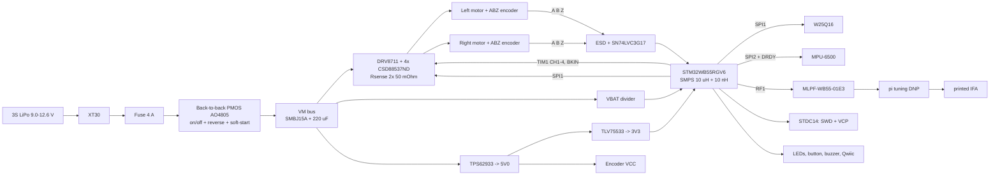

# Architecture

## Block diagram

Pins: `docs/pinmap.md`. Parts and stock: `bom/parts.csv`, checked by `scripts/jlc_stock.py`.

## Power tree and budget

Numbers marked **A** are ASSUMPTIONS to replace with datasheet maxima during the schematic phase.

| Rail | Load | Current | Source |
|---|---|---|---|
| 3V3 | STM32WB55, CPU + radio (TX 0 dBm 8.8 mA, SMPS bypass) | 30 mA | DS11929 radio current table; CPU allowance **A** |
| 3V3 | MPU-6500 accel + gyro | 3.5 mA | **A**, check the MPU-6500 datasheet |
| 3V3 | W25Q16 program/erase peak | 25 mA | **A**, check the W25Q16JV datasheet |
| 3V3 | 2 LEDs at 2 mA, 2 × LVC3G17 | 5 mA | design choice |
| 3V3 | Qwiic allowance | 50 mA | design choice |
| **3V3 total** | | **≈ 115 mA** | TLV75533 (500 mA): (5.0 − 3.3) × 0.115 ≈ 0.20 W |
| 5V0 | 3V3 rail | 115 mA | above |
| 5V0 | 2 ABZ encoders | 60 mA | **A**, 30 mA each typical for optical/magnetic ABZ |
| 5V0 | Buzzer (MLT-8530 via NPN) | 90 mA peak | **A**, check the MLT-8530 datasheet |
| **5V0 total** | | **≈ 265 mA** | TPS62933 (3 A), plenty of margin |
| VBAT | 5V0 buck input at 9.9 V, η ≈ 0.85 | ≈ 160 mA | 5 × 0.265 / 0.85 / 9.9 |
| VBAT | Two motors at I_trip (peak) | 2 × 1.3 A | S0 |
| VBAT | Two motors, continuous (rated) | 2 × 0.45 A | JGA25-370 listing |
| **VBAT peak** | | **≈ 2.8 A** | 4 A fuse (about 75 % derating → 3 A continuous) |

## Safety chain (hardware part)

1. Power-on and reset (REQ-SYS-002, REQ-SAFE-009):
   - pull-downs on AIN1/AIN2/BIN1/BIN2 hold every bridge input low (tri-state);
   - a pull-down on SLEEPn keeps the DRV8711 asleep;
   - the DRV8711's SCS pull-down keeps SPI1 traffic from reaching it until firmware selects it.
2. A driver fault (nFAULT, open-drain) reaches TIM1_BKIN (PA6), which tri-states all four inputs in hardware with no firmware involved. It also reaches EXTI4 (PC4) to latch the fault (REQ-DRIVE-004).
3. Switching off the board while the wheels spin: the bridges' body diodes rectify the motor back-EMF onto VM, where the 220 µF and the SMBJ15A absorb it (HW-PWR-004, verified in S1).
4. The battery voltage is visible to the MCU (PC1) for the undervoltage fault (HW-PWR-006).
